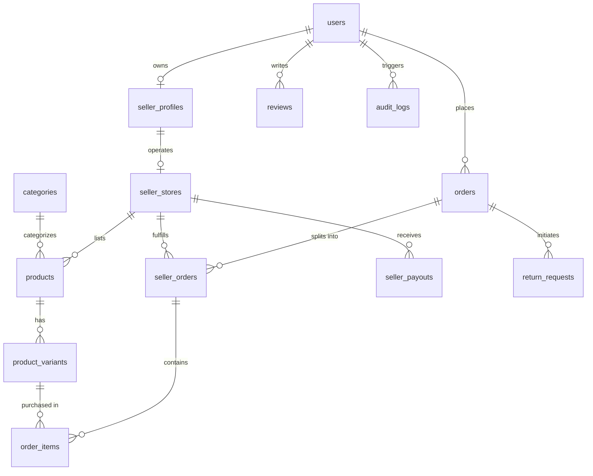

# Database Migration Plan

## 1. Migration Strategy & Non-Destructive Principles
- **No Destructive Drops**: Existing columns and tables (`users`, `categories`, `products`, `product_variants`, `orders`, `order_items`, `reviews`) will NOT be deleted or dropped.
- **Additive Evolution**: New tables and nullable or default-valued columns will be introduced.
- **Backfill Strategy**: A default system seller store will be created for the initial administrator (`sumrasamir27@gmail.com`) so that any existing and new products maintain unambiguous seller ownership.
- **Transactional Migrations**: All migration statements are executed inside PostgreSQL transactions (`BEGIN ... COMMIT`) to ensure atomicity.

---

## 2. Target Entity-Relationship Model

---

## 3. Schema Alterations & New Tables

### Existing Tables Extended
1. **`users`**
   - Add column: `phone VARCHAR(32)`
   - Add column: `is_verified BOOLEAN DEFAULT false`
   - Update role enum/constraint: `'customer'`, `'seller'`, `'admin'`, `'super_admin'`

2. **`products`**
   - Add column: `seller_id INTEGER REFERENCES users(id) ON DELETE SET NULL`
   - Add column: `store_id INTEGER` (will reference `seller_stores(id)`)
   - Add column: `brand VARCHAR(120)`
   - Add column: `clothing_type VARCHAR(80)`
   - Add column: `fabric_material VARCHAR(120)`
   - Add column: `fit VARCHAR(60)`
   - Add column: `pattern VARCHAR(60)`
   - Add column: `season VARCHAR(60)`
   - Add column: `care_instructions TEXT`
   - Add column: `status VARCHAR(30) DEFAULT 'approved'` (options: `draft`, `pending_approval`, `approved`, `rejected`, `archived`)
   - Add column: `moderation_note TEXT`
   - Add column: `seo_title VARCHAR(255)`
   - Add column: `seo_description TEXT`
   - Add index: `idx_products_seller_id`, `idx_products_status`, `idx_products_category_id`

3. **`product_variants`**
   - Add column: `compare_at_price NUMERIC(10,2)`
   - Add column: `low_stock_threshold INTEGER DEFAULT 5`
   - Add column: `barcode VARCHAR(100)`
   - Add column: `weight_grams INTEGER`
   - Add column: `is_active BOOLEAN DEFAULT true`
   - Add index: `idx_variants_product_id`, `idx_variants_sku`

4. **`orders`**
   - Add column: `payment_status VARCHAR(40) DEFAULT 'pending'`
   - Add column: `subtotal NUMERIC(10,2)`
   - Add column: `shipping_fee NUMERIC(10,2)`
   - Add column: `tax_amount NUMERIC(10,2)`
   - Add column: `discount_amount NUMERIC(10,2) DEFAULT 0`

5. **`order_items`**
   - Add column: `seller_id INTEGER REFERENCES users(id)`
   - Add column: `seller_order_id INTEGER` (references `seller_orders(id)`)
   - Add column: `commission_rate NUMERIC(5,2) DEFAULT 10.00`
   - Add column: `commission_amount NUMERIC(10,2) DEFAULT 0`
   - Add column: `seller_net_amount NUMERIC(10,2) DEFAULT 0`
   - Add column: `fulfillment_status VARCHAR(40) DEFAULT 'unfulfilled'`

---

### New Marketplace Tables

6. **`seller_applications`**
   - Columns: `id SERIAL PRIMARY KEY`, `user_id INT REFERENCES users(id) ON DELETE CASCADE`, `business_name VARCHAR(255) NOT NULL`, `business_email VARCHAR(255) NOT NULL`, `phone VARCHAR(50)`, `tax_id VARCHAR(100)`, `document_urls TEXT[]`, `status VARCHAR(40) DEFAULT 'pending'`, `admin_notes TEXT`, `reviewed_by INT REFERENCES users(id)`, `reviewed_at TIMESTAMPTZ`, `created_at TIMESTAMPTZ DEFAULT NOW()`

7. **`seller_stores`**
   - Columns: `id SERIAL PRIMARY KEY`, `user_id INT UNIQUE REFERENCES users(id) ON DELETE CASCADE`, `name VARCHAR(255) NOT NULL`, `slug VARCHAR(255) UNIQUE NOT NULL`, `logo_url TEXT`, `banner_url TEXT`, `bio TEXT`, `policy_return TEXT`, `policy_shipping TEXT`, `commission_rate NUMERIC(5,2) DEFAULT 10.00`, `is_active BOOLEAN DEFAULT true`, `is_featured BOOLEAN DEFAULT false`, `created_at TIMESTAMPTZ DEFAULT NOW()`

8. **`seller_orders`** (Fulfillment Group per Seller per Checkout)
   - Columns: `id SERIAL PRIMARY KEY`, `order_id INT REFERENCES orders(id) ON DELETE CASCADE`, `seller_id INT REFERENCES users(id)`, `store_id INT REFERENCES seller_stores(id)`, `subtotal NUMERIC(10,2) NOT NULL`, `shipping_fee NUMERIC(10,2) DEFAULT 0`, `commission_amount NUMERIC(10,2) NOT NULL`, `seller_net_earnings NUMERIC(10,2) NOT NULL`, `status VARCHAR(40) DEFAULT 'unfulfilled'`, `tracking_number VARCHAR(120)`, `shipping_carrier VARCHAR(100)`, `shipped_at TIMESTAMPTZ`, `delivered_at TIMESTAMPTZ`, `created_at TIMESTAMPTZ DEFAULT NOW()`

9. **`commission_rules`**
   - Columns: `id SERIAL PRIMARY KEY`, `rule_type VARCHAR(40) NOT NULL` (e.g. `global`, `category`, `seller`), `target_id INT`, `rate NUMERIC(5,2) NOT NULL`, `effective_from TIMESTAMPTZ DEFAULT NOW()`, `is_active BOOLEAN DEFAULT true`, `created_at TIMESTAMPTZ DEFAULT NOW()`

10. **`seller_payouts`**
    - Columns: `id SERIAL PRIMARY KEY`, `seller_id INT REFERENCES users(id)`, `store_id INT REFERENCES seller_stores(id)`, `amount NUMERIC(10,2) NOT NULL`, `status VARCHAR(40) DEFAULT 'pending'`, `payout_method VARCHAR(50) DEFAULT 'bank_transfer'`, `reference_id VARCHAR(120)`, `notes TEXT`, `processed_by INT REFERENCES users(id)`, `processed_at TIMESTAMPTZ`, `created_at TIMESTAMPTZ DEFAULT NOW()`

11. **`return_requests`**
    - Columns: `id SERIAL PRIMARY KEY`, `order_id INT REFERENCES orders(id)`, `order_item_id INT REFERENCES order_items(id)`, `seller_id INT REFERENCES users(id)`, `user_id INT REFERENCES users(id)`, `reason VARCHAR(255) NOT NULL`, `details TEXT`, `image_urls TEXT[]`, `status VARCHAR(40) DEFAULT 'pending'`, `refund_amount NUMERIC(10,2)`, `restock_inventory BOOLEAN DEFAULT false`, `admin_notes TEXT`, `created_at TIMESTAMPTZ DEFAULT NOW()`

12. **`audit_logs`**
    - Columns: `id SERIAL PRIMARY KEY`, `user_id INT REFERENCES users(id)`, `action VARCHAR(100) NOT NULL`, `target_entity VARCHAR(100) NOT NULL`, `target_id INT`, `ip_address VARCHAR(45)`, `details JSONB`, `created_at TIMESTAMPTZ DEFAULT NOW()`

13. **`ai_usage_logs`**
    - Columns: `id SERIAL PRIMARY KEY`, `user_id INT REFERENCES users(id)`, `feature VARCHAR(100) NOT NULL`, `tokens_used INT DEFAULT 0`, `model VARCHAR(100)`, `status VARCHAR(40) DEFAULT 'success'`, `created_at TIMESTAMPTZ DEFAULT NOW()`

---

## 4. Backfill Strategy
1. Select or create default store for primary admin user (`sumrasamir27@gmail.com`).
2. Update existing products: `UPDATE products SET seller_id = 1, store_id = 1, status = 'approved' WHERE seller_id IS NULL`.
3. Existing orders and order items backfilled to ensure `seller_id = 1` for integrity.
